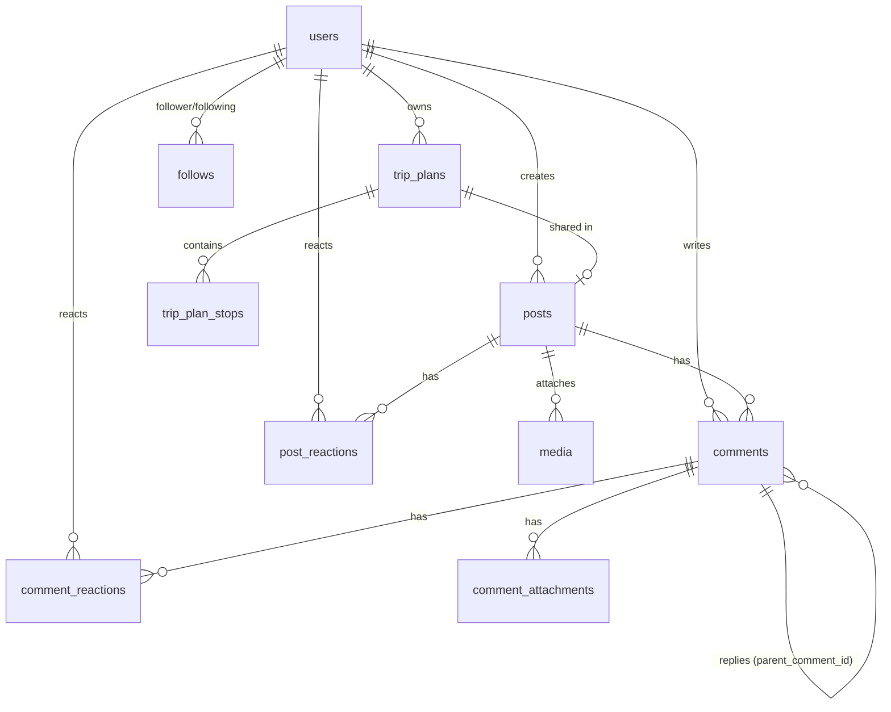

# Triplex Node Backend API Documentation

Welcome to the API documentation for the **Triplex** Node.js backend. This document provides a complete guide to all endpoints, authentication mechanisms, request/response formats, error codes, and database models.

---

## 1. Overview & Server Setup

- **Base URL**: `http://localhost:3000/api` (or configured `PORT`)
- **Content Type**: `application/json` (unless uploading files via `multipart/form-data`)
- **Database**: PostgreSQL (pg pool connection)
- **File Storage**: Cloudinary (for avatar/media uploads)

---

## 2. Authentication Strategy

The API uses **JSON Web Tokens (JWT)** for stateless authentication.

### Tokens
- **Access Token**: Short-lived (`15m`). Passed in HTTP `Authorization` header as `Bearer <token>`.
- **Refresh Token**: Long-lived (`7d`). Used to request a new Access & Refresh token pair without requiring user password re-entry.

### Token Revocation & Security (`token_version`)
Each user record has a `token_version` integer in the database:
- Modifying security settings (e.g., changing password, changing username, or changing email) increments `token_version`.
- Any existing refresh token with an old `token_version` is invalidated (`403 Forbidden`).

---

## 3. Endpoints Reference

### 3.1 System & Health

#### `GET /api/health`
Checks backend health and database connectivity.
- **Auth Required**: No
- **Response `200 OK`**:
```json
{
  "status": "success",
  "message": "Database connected successfully",
  "timestamp": "2026-08-01T15:00:00.000Z"
}
```
- **Error Response `500 Internal Server Error`**:
```json
{
  "status": "error",
  "message": "Database connection failed",
  "error": "..."
}
```

---

### 3.2 Authentication (`/api/auth`)

#### `POST /api/auth/register`
Register a new user account.
- **Auth Required**: No
- **Request Body**:
```json
{
  "username": "johndoe",
  "email": "john@example.com",
  "password": "securepassword123"
}
```
- **Response `201 Created`**:
```json
{
  "status": "success",
  "message": "auth/register_success",
  "accessToken": "<jwt_access_token>",
  "refreshToken": "<jwt_refresh_token>",
  "user": {
    "id": "uuid-v4",
    "username": "johndoe",
    "email": "john@example.com",
    "avatar_url": null
  }
}
```
- **Error Responses**:
  - `400 Bad Request`: `auth/register_missing_fields`, `auth/register_empty_fields`, `auth/register_email_username_exists`
  - `500 Internal Server Error`: `auth/register_failed`

---

#### `POST /api/auth/login`
Log in using email and password.
- **Auth Required**: No
- **Request Body**:
```json
{
  "email": "john@example.com",
  "password": "securepassword123"
}
```
- **Response `200 OK`**:
```json
{
  "status": "success",
  "message": "auth/login_success",
  "accessToken": "<jwt_access_token>",
  "refreshToken": "<jwt_refresh_token>",
  "user": {
    "id": "uuid-v4",
    "username": "johndoe",
    "email": "john@example.com",
    "avatar_url": "https://..."
  }
}
```
- **Error Responses**:
  - `400 Bad Request`: `auth/login_invalid_email_password`
  - `500 Internal Server Error`: `Failed to log in`

---

#### `POST /api/auth/login-username`
Log in using username and password.
- **Auth Required**: No
- **Request Body**:
```json
{
  "username": "johndoe",
  "password": "securepassword123"
}
```
- **Response `200 OK`**:
```json
{
  "status": "success",
  "message": "auth/login_success",
  "accessToken": "<jwt_access_token>",
  "refreshToken": "<jwt_refresh_token>",
  "user": {
    "id": "uuid-v4",
    "username": "johndoe",
    "email": "john@example.com",
    "avatar_url": "https://..."
  }
}
```
- **Error Responses**:
  - `400 Bad Request`: `auth/login_invalid_email_password`
  - `500 Internal Server Error`: `auth/login_failed`

---

#### `POST /api/auth/refresh`
Exchange a valid Refresh Token for a new pair of Access & Refresh tokens.
- **Auth Required**: No
- **Request Body**:
```json
{
  "refreshToken": "<jwt_refresh_token>"
}
```
- **Response `200 OK`**:
```json
{
  "status": "success",
  "message": "auth/token_refreshed",
  "accessToken": "<new_jwt_access_token>",
  "refreshToken": "<new_jwt_refresh_token>",
  "user": {
    "id": "uuid-v4",
    "username": "johndoe",
    "email": "john@example.com",
    "avatar_url": "https://..."
  }
}
```
- **Error Responses**:
  - `401 Unauthorized`: `auth/missing_refresh_token`
  - `403 Forbidden`: `auth/user_not_found`, `auth/token_revoked`, `auth/invalid_refresh_token`

---

### 3.3 Profile & Settings (`/api/profile`)

#### `POST /api/profile/check-username`
Check if a username is available for registration or change.
- **Auth Required**: No
- **Request Body**:
```json
{
  "username": "newusername"
}
```
- **Response `200 OK`**:
```json
{
  "status": "success",
  "available": true,
  "message": "Username is available"
}
```

---

#### `GET /api/profile/me`
Fetch current authenticated user profile details.
- **Auth Required**: Yes (`Bearer <token>`)
- **Response `200 OK`**:
```json
{
  "status": "success",
  "message": "profile/fetch_success",
  "user": {
    "id": "uuid-v4",
    "username": "johndoe",
    "email": "john@example.com",
    "name": "John Doe",
    "phone": "+1234567890",
    "avatar_url": "https://..."
  }
}
```
- **Error Responses**:
  - `401 Unauthorized`: `auth/missing_token`, `auth/invalid_token`
  - `404 Not Found`: `profile/user_not_found`

---

#### `POST /api/profile/profile-picture`
Upload/update user profile avatar image via Cloudinary.
- **Auth Required**: Yes (`Bearer <token>`)
- **Content Type**: `multipart/form-data`
- **Form Data Field**: `image` (file)
- **Response `200 OK`**:
```json
{
  "status": "success",
  "message": "profile/picture_updated_successfully",
  "avatarUrl": "https://res.cloudinary.com/...",
  "mediaId": "uuid-v4"
}
```
- **Error Responses**:
  - `400 Bad Request`: `profile/no_file_uploaded`
  - `500 Internal Server Error`: `profile/update_failed`

---

#### `PUT /api/profile/change-username`
Change the authenticated user's username. Validates username format (3-30 chars, alphanumeric and underscore). Issues new tokens due to token version increment.
- **Auth Required**: Yes (`Bearer <token>`)
- **Request Body**:
```json
{
  "newUsername": "john_doe_renamed"
}
```
- **Response `200 OK`**:
```json
{
  "status": "success",
  "message": "profile/change_username_success",
  "newUsername": "john_doe_renamed",
  "user": {
    "id": "uuid-v4",
    "username": "john_doe_renamed",
    "email": "john@example.com",
    "name": "John Doe",
    "phone": "+1234567890",
    "avatar_url": "https://..."
  },
  "accessToken": "<new_access_token>",
  "refreshToken": "<new_refresh_token>"
}
```
- **Error Responses**:
  - `400 Bad Request`: `profile/change_username_missing_fields`, `profile/change_username_invalid_format`, `profile/change_username_username_taken`

---

#### `PUT /api/profile/change-email`
Change the authenticated user's email address (validates email format and requires current password verification). Issues new tokens due to token version increment.
- **Auth Required**: Yes (`Bearer <token>`)
- **Request Body**:
```json
{
  "newEmail": "newemail@example.com",
  "password": "currentpassword"
}
```
- **Response `200 OK`**:
```json
{
  "status": "success",
  "message": "profile/change_email_success",
  "newEmail": "newemail@example.com",
  "user": {
    "id": "uuid-v4",
    "username": "johndoe",
    "email": "newemail@example.com",
    "name": "John Doe",
    "phone": "+1234567890",
    "avatar_url": "https://..."
  },
  "accessToken": "<new_access_token>",
  "refreshToken": "<new_refresh_token>"
}
```
- **Error Responses**:
  - `400 Bad Request`: `profile/change_email_missing_fields`, `profile/change_email_invalid_format`, `profile/change_email_invalid_password`, `profile/change_email_email_taken`
  - `404 Not Found`: `profile/change_email_user_not_found`

---

### 3.4 User Profiles & Relationships (`/api/users`)

#### `GET /api/users/profile/:userId`
Fetch user profile by user UUID or username along with follower/following/posts counts and follow status.
- **Auth Required**: Optional (`Bearer <token>` adds `is_following` and `is_self`)
- **Parameters**:
  - `userId`: User UUID or username
- **Response `200 OK`**:
```json
{
  "status": "success",
  "user": {
    "id": "uuid-v4",
    "username": "johndoe",
    "email": "john@example.com",
    "name": "John Doe",
    "phone": "+1234567890",
    "avatar_url": "https://...",
    "created_at": "2026-01-01T00:00:00.000Z",
    "followersCount": 42,
    "followingCount": 15,
    "postsCount": 8,
    "is_following": false,
    "is_self": false
  }
}
```
- **Error Responses**:
  - `404 Not Found`: `user/not_found`

---

#### `PUT /api/users/profile`
Update optional user profile fields (`name`, `phone`).
- **Auth Required**: Yes (`Bearer <token>`)
- **Request Body**:
```json
{
  "name": "Johnathan Doe",
  "phone": "+1987654321"
}
```
- **Response `200 OK`**:
```json
{
  "status": "success",
  "user": {
    "id": "uuid-v4",
    "username": "johndoe",
    "email": "john@example.com",
    "name": "Johnathan Doe",
    "phone": "+1987654321",
    "avatar_url": "https://...",
    "updated_at": "2026-08-01T15:00:00.000Z"
  }
}
```

---

#### `POST /api/users/follow/:userId`
Follow another user by user ID or username.
- **Auth Required**: Yes (`Bearer <token>`)
- **Parameters**:
  - `userId`: Target user UUID or username
- **Response `200 OK`**:
```json
{
  "status": "success",
  "message": "user/followed_successfully",
  "is_following": true,
  "followersCount": 43
}
```
- **Error Responses**:
  - `400 Bad Request`: `user/cannot_follow_self`
  - `404 Not Found`: `user/not_found`

---

#### `DELETE /api/users/unfollow/:userId`
Unfollow a user by user ID or username.
- **Auth Required**: Yes (`Bearer <token>`)
- **Parameters**:
  - `userId`: Target user UUID or username
- **Response `200 OK`**:
```json
{
  "status": "success",
  "message": "user/unfollowed_successfully",
  "is_following": false,
  "followersCount": 42
}
```
- **Error Responses**:
  - `404 Not Found`: `user/not_found`

---

#### `GET /api/users/:userId/followers`
Fetch list of followers for a user.
- **Auth Required**: Optional (`Bearer <token>` adds `is_following` and `is_self`)
- **Parameters**:
  - `userId`: User UUID or username
- **Response `200 OK`**:
```json
{
  "status": "success",
  "followers": [
    {
      "id": "uuid-v4",
      "username": "follower_user",
      "name": "Follower Name",
      "avatar_url": "https://...",
      "created_at": "2026-08-01T12:00:00.000Z",
      "is_following": false,
      "is_self": false
    }
  ]
}
```

---

#### `GET /api/users/:userId/following`
Fetch list of users that a user is following.
- **Auth Required**: Optional (`Bearer <token>` adds `is_following` and `is_self`)
- **Parameters**:
  - `userId`: User UUID or username
- **Response `200 OK`**:
```json
{
  "status": "success",
  "following": [
    {
      "id": "uuid-v4",
      "username": "followed_user",
      "name": "Followed Name",
      "avatar_url": "https://...",
      "created_at": "2026-08-01T12:00:00.000Z",
      "is_following": true,
      "is_self": false
    }
  ]
}
```

---

### 3.5 Map & Places Services (`/api/map`)

#### `GET /api/map/autocomplete`
Fetch location autocomplete suggestions using Google Places API (New).
- **Auth Required**: Yes (`Bearer <token>`)
- **Query Parameters**:
  - `input` (string, **required**): Search text
  - `sessionToken` (string, optional): Autocomplete session UUID token
  - `locationBias` (string / JSON object, optional): Bias bounds/circle
  - `includedRegionCodes` (string / array, optional): Comma-separated ISO region codes (e.g. `US,KH`)
  - `languageCode` (string, optional): Language code (e.g. `en`)
- **Response `200 OK`**:
```json
{
  "status": "success",
  "suggestions": [
    {
      "placeId": "ChIJN1t_tDeuEmsRUsoyG83frY4",
      "displayName": "Sydney Opera House",
      "formattedAddress": "Bennelong Point, Sydney NSW, Australia",
      "types": ["tourist_attraction", "point_of_interest", "establishment"]
    }
  ]
}
```

---

#### `GET /api/map/details/:placeId`
Fetch details (id, display name, address, lat/lng) for a place.
- **Auth Required**: Yes (`Bearer <token>`)
- **Query Parameters**:
  - `sessionToken` (string, optional): Session UUID matching autocomplete
- **Response `200 OK`**:
```json
{
  "status": "success",
  "place": {
    "placeId": "ChIJN1t_tDeuEmsRUsoyG83frY4",
    "displayName": "Sydney Opera House",
    "formattedAddress": "Bennelong Point, Sydney NSW, Australia",
    "latitude": -33.8567844,
    "longitude": 151.2152967
  }
}
```

---

#### `POST /api/map/details-by-id`
Fetch extended place details (rating, phone, opening hours, photos) via Google Places Web API.
- **Auth Required**: Yes (`Bearer <token>`)
- **Request Body**:
```json
{
  "placeId": "ChIJN1t_tDeuEmsRUsoyG83frY4"
}
```
- **Response `200 OK`**:
```json
{
  "status": "success",
  "place": {
    "name": "Sydney Opera House",
    "rating": 4.7,
    "user_ratings_total": 45200,
    "status": "Open",
    "formatted_phone_number": "+61 2 9250 7111",
    "photos": [...]
  }
}
```

---

### 3.6 Trip Plans (`/api/trip-plans`)

#### `POST /api/trip-plans`
Create a new trip plan with start, waypoints, and end stops. Costs are aggregated automatically via database trigger.
- **Auth Required**: Yes (`Bearer <token>`)
- **Request Body**:
```json
{
  "title": "Summer Beach Trip",
  "caption": "A 3-day beach road trip",
  "start": {
    "title": "Home",
    "location": "Phnom Penh",
    "placeId": "ChIJ...",
    "latitude": 11.5564,
    "longitude": 104.9282,
    "description": "Starting point",
    "cost": 0,
    "currency": "USD"
  },
  "waypoints": [
    {
      "title": "Gas Station",
      "location": "Kampot",
      "cost": 25.50,
      "currency": "USD"
    }
  ],
  "end": {
    "title": "Beach Resort",
    "location": "Sihanoukville",
    "cost": 150.00,
    "currency": "USD"
  }
}
```
- **Response `201 Created`**:
```json
{
  "status": "success",
  "data": {
    "tripPlan": {
      "id": "uuid-v4",
      "owner_id": "uuid-v4",
      "title": "Summer Beach Trip",
      "caption": "A 3-day beach road trip",
      "total_cost": 175.50,
      "total_cost_currency": "USD",
      "created_at": "2026-08-01T15:00:00.000Z",
      "updated_at": "2026-08-01T15:00:00.000Z"
    },
    "stops": [...]
  }
}
```

---

#### `GET /api/trip-plans`
Fetch all trip plans created by the authenticated user.
- **Auth Required**: Yes (`Bearer <token>`)
- **Response `200 OK`**:
```json
{
  "status": "success",
  "data": [
    {
      "id": "uuid-v4",
      "owner_id": "uuid-v4",
      "title": "Summer Beach Trip",
      "caption": "...",
      "total_cost": 175.50,
      "total_cost_currency": "USD",
      "start": { ... },
      "waypoints": [ ... ],
      "end": { ... }
    }
  ]
}
```

---

#### `GET /api/trip-plans/:id`
Fetch a specific trip plan by ID.
- **Auth Required**: Yes (`Bearer <token>`)
- **Response `200 OK`**:
```json
{
  "status": "success",
  "data": {
    "id": "uuid-v4",
    "owner_id": "uuid-v4",
    "title": "Summer Beach Trip",
    "caption": "...",
    "total_cost": 175.50,
    "total_cost_currency": "USD",
    "start": { ... },
    "waypoints": [ ... ],
    "end": { ... }
  }
}
```

---

#### `DELETE /api/trip-plans/:id`
Delete a trip plan owned by the authenticated user.
- **Auth Required**: Yes (`Bearer <token>`)
- **Response `200 OK`**:
```json
{
  "status": "success",
  "message": "Trip plan deleted successfully",
  "data": { "id": "uuid-v4" }
}
```

---

### 3.7 Posts & Feed (`/api/posts`)

#### `POST /api/posts`
Create a new social post. Supports type `'trip_plan'`, `'media'`, or `'trip_plan_media'`. Accepts `application/json` or `multipart/form-data` (with file array parameter `media`).
- **Auth Required**: Yes (`Bearer <token>`)
- **Content-Type**: `application/json` or `multipart/form-data`
- **Request Parameters / Form Fields**:
  - `type` (string, optional): `'trip_plan'`, `'media'`, or `'trip_plan_media'` (inferred automatically if omitted based on presence of trip_plan/media)
  - `caption` (string, optional): Post caption
  - `trip_plan` (object or JSON string, optional): Inline trip plan object containing `title`, `caption`, `start`, `waypoints`, `end`
  - `media` (file or file array, optional): Image/video file attachments
- **Response `201 Created`**:
```json
{
  "status": "success",
  "data": {
    "id": "uuid-v4",
    "type": "trip_plan_media",
    "caption": "Check out my new trip plan with photos!",
    "created_at": "2026-08-01T15:00:00.000Z",
    "user": {
      "id": "uuid-v4",
      "username": "johndoe",
      "name": "John Doe",
      "avatar_url": "https://..."
    },
    "media": [
      {
        "id": "uuid-v4",
        "cloud_url": "https://res.cloudinary.com/...",
        "public_id": "post_media/...",
        "type": "image",
        "sort_order": 0
      }
    ],
    "media_urls": [
      "https://res.cloudinary.com/..."
    ],
    "tripPlan": { ... }
  }
}
```

---

#### `GET /api/posts/feed`
Fetch main social feed posts in reverse chronological order. Returns `media` array and `media_urls` list for attached media images/videos, plus current user's reaction status (`is_liked`, `my_reaction`).
- **Auth Required**: Yes (`Bearer <token>`) / Optional
- **Response `200 OK`**:
```json
{
  "status": "success",
  "data": [
    {
      "id": "uuid-v4",
      "type": "trip_plan_media",
      "caption": "...",
      "likes_count": 42,
      "comments_count": 5,
      "is_liked": true,
      "my_reaction": "love",
      "created_at": "2026-08-01T15:00:00.000Z",
      "updated_at": "2026-08-01T15:00:00.000Z",
      "user": { ... },
      "media": [ ... ],
      "media_urls": [ ... ],
      "tripPlan": { ... }
    }
  ]
}
```

---

#### `GET /api/posts/:postId`
Fetch single post by post ID.
- **Auth Required**: No (optional auth adds `is_liked` / `my_reaction`)
- **Response `200 OK`**:
```json
{
  "status": "success",
  "data": {
    "id": "uuid-v4",
    "type": "trip_plan",
    "caption": "...",
    "likes_count": 42,
    "comments_count": 5,
    "is_liked": true,
    "my_reaction": "love",
    "user": { ... },
    "tripPlan": { ... }
  }
}
```

---

#### `GET /api/posts/user/:userId`
Fetch all posts published by a specific user.
- **Auth Required**: No (optional auth adds `is_liked` / `my_reaction`)
- **Response `200 OK`**:
```json
{
  "status": "success",
  "data": [ ... ]
}
```

---

#### `POST /api/posts/:postId/repost`
Repost an existing post (with optional caption quote).
- **Auth Required**: Yes (`Bearer <token>`)
- **Request Body** (optional):
```json
{
  "caption": "Check out this amazing trip plan!"
}
```
- **Response `201 Created`**:
```json
{
  "status": "success",
  "message": "post/reposted_successfully",
  "data": {
    "id": "uuid-v4",
    "type": "repost",
    "caption": "Check out this amazing trip plan!",
    "likes_count": 0,
    "comments_count": 0,
    "repost_count": 0,
    "repost_id": "<original-post-uuid>",
    "is_liked": false,
    "is_reposted": false,
    "created_at": "2026-08-01T15:00:00.000Z",
    "updated_at": "2026-08-01T15:00:00.000Z",
    "user": { ... },
    "reposted_post": {
      "id": "<original-post-uuid>",
      "type": "trip_plan_media",
      "caption": "Original post caption",
      "user": { ... },
      "media_urls": [ ... ],
      "tripPlan": { ... }
    }
  }
}
```

---

#### `PUT /api/posts/:postId`
Update caption of a post owned by authenticated user.
- **Auth Required**: Yes (`Bearer <token>`)
- **Request Body**:
```json
{
  "caption": "Updated post caption"
}
```
- **Response `200 OK`**:
```json
{
  "status": "success",
  "data": {
    "id": "uuid-v4",
    "caption": "Updated post caption",
    "updated_at": "2026-08-01T15:00:00.000Z"
  }
}
```

---

#### `DELETE /api/posts/:postId`
Delete a post owned by authenticated user.
- **Auth Required**: Yes (`Bearer <token>`)
- **Response `200 OK`**:
```json
{
  "status": "success",
  "message": "post/deleted_successfully"
}
```

---

### 3.8 Comments & Replies (`/api/comments`)

#### `POST /api/comments/:postId/comments`
Add a top-level comment or a reply to a post. Pass `parentCommentId` in the body to make it a reply.
- **Auth Required**: Yes (`Bearer <token>`)
- **Request Body**:
```json
{
  "content": "Awesome trip plan!",
  "parentCommentId": null
}
```
> `parentCommentId` — omit or set `null` for a top-level comment; set to an existing top-level comment's UUID to make this a reply.

- **Response `201 Created`**:
```json
{
  "status": "success",
  "data": {
    "id": "uuid-v4",
    "post_id": "uuid-v4",
    "parent_comment_id": null,
    "content": "Awesome trip plan!",
    "is_deleted": false,
    "likes_count": 0,
    "replies_count": 0,
    "is_reacted": false,
    "my_reaction": null,
    "created_at": "2026-08-01T15:00:00.000Z",
    "updated_at": "2026-08-01T15:00:00.000Z",
    "user": {
      "id": "uuid-v4",
      "username": "johndoe",
      "name": "John Doe",
      "avatar_url": "https://..."
    }
  }
}
```
- **Error Responses**:
  - `400 Bad Request`: `comment/content_required`
  - `404 Not Found`: `post/not_found`, `comment/parent_not_found`

---

#### `GET /api/comments/:postId/comments`
Fetch **top-level** comments for a post (ordered oldest first). Replies are lazy-loaded separately.
- **Auth Required**: No (optional auth adds `is_reacted` / `my_reaction`)
- **Response `200 OK`**:
```json
{
  "status": "success",
  "data": [
    {
      "id": "uuid-v4",
      "post_id": "uuid-v4",
      "parent_comment_id": null,
      "content": "Awesome trip plan!",
      "is_deleted": false,
      "likes_count": 12,
      "replies_count": 3,
      "is_reacted": true,
      "my_reaction": "like",
      "created_at": "2026-08-01T15:00:00.000Z",
      "updated_at": "2026-08-01T15:00:00.000Z",
      "user": { ... }
    }
  ]
}
```

---

#### `GET /api/comments/:commentId/replies`
Lazy-load all direct replies to a comment.
- **Auth Required**: No (optional auth adds `is_reacted` / `my_reaction`)
- **Response `200 OK`**:
```json
{
  "status": "success",
  "data": [
    {
      "id": "uuid-v4",
      "post_id": "uuid-v4",
      "parent_comment_id": "<parent-uuid>",
      "content": "Same! Love this route.",
      "is_deleted": false,
      "likes_count": 2,
      "replies_count": 0,
      "is_reacted": false,
      "my_reaction": null,
      "created_at": "2026-08-01T15:05:00.000Z",
      "updated_at": "2026-08-01T15:05:00.000Z",
      "user": { ... }
    }
  ]
}
```
- **Error Responses**:
  - `404 Not Found`: `comment/not_found`

---

#### `POST /api/comments/:commentId/replies`
Convenience endpoint — creates a reply directly under a parent comment (no need to specify `postId`).
- **Auth Required**: Yes (`Bearer <token>`)
- **Request Body**:
```json
{
  "content": "Totally agree!"
}
```
- **Response `201 Created`**: Same shape as `POST /comments/:postId/comments` with `parent_comment_id` set.
- **Error Responses**:
  - `400 Bad Request`: `comment/content_required`
  - `404 Not Found`: `comment/parent_not_found`

---

#### `POST /api/comments/:commentId/like`
React to a comment.
- **Auth Required**: Yes (`Bearer <token>`)
- **Request Body** (optional — defaults to `"like"`):
```json
{ "type": "like" }
```
> Valid types: `like` (👍) | `love` (❤️) | `haha` (😂) | `wow` (😮) | `sad` (😢) | `cry` (😭) | `angry` (😡)

- **Response `200 OK`**:
```json
{
  "status": "success",
  "message": "reaction/reacted_successfully",
  "reactions": [ { "type": "like", "count": "5" } ],
  "my_reactions": ["like"]
}
```

---

#### `DELETE /api/comments/:commentId/like`
Remove a reaction from a comment.
- **Auth Required**: Yes (`Bearer <token>`)
- **Request Body** (optional — defaults to `"like"`):
```json
{ "type": "like" }
```
- **Response `200 OK`**:
```json
{
  "status": "success",
  "message": "reaction/removed_successfully",
  "reactions": [],
  "my_reactions": []
}
```

---

#### `DELETE /api/comments/comment/:commentId`
Soft-delete a comment owned by the authenticated user. Content is hidden but the row persists so replies remain intact.
- **Auth Required**: Yes (`Bearer <token>`)
- **Response `200 OK`**:
```json
{
  "status": "success",
  "message": "comment/deleted_successfully"
}
```
- **Error Responses**:
  - `403 Forbidden`: `comment/unauthorized`
  - `404 Not Found`: `comment/not_found`
  - `410 Gone`: `comment/already_deleted`

---

### 3.9 Reactions (`/api/likes`)

The likes system has been upgraded to **scalable reactions**. Reaction types: `like` (👍) | `love` (❤️) | `haha` (😂) | `wow` (😮) | `sad` (😢) | `cry` (😭) | `angry` (😡). Omitting `type` defaults to `"like"` for full backward compatibility. Each user can have at most **one** reaction per post. Selecting a different reaction switches the reaction in-place; selecting the same reaction removes it.

Counters (`posts.likes_count`) are maintained by DB triggers — no extra round-trips.

#### `POST /api/likes/:postId/like`
React to a post.
- **Auth Required**: Yes (`Bearer <token>`)
- **Request Body** (optional):
```json
{ "type": "love" }
```
- **Response `200 OK`**:
```json
{
  "status": "success",
  "message": "reaction/reacted_successfully",
  "likes_count": 43,
  "is_liked": true,
  "my_reaction": "love",
  "reactions": [
    { "type": "like", "count": "42" },
    { "type": "love", "count": "1" }
  ],
  "my_reactions": ["love"]
}
```
- **Error Responses**:
  - `400 Bad Request`: `reaction/invalid_type`
  - `404 Not Found`: `post/not_found`

---

#### `DELETE /api/likes/:postId/like`
Remove a reaction from a post.
- **Auth Required**: Yes (`Bearer <token>`)
- **Request Body** (optional — defaults to removing the user's active reaction):
```json
{ "type": "love" }
```
- **Response `200 OK`**:
```json
{
  "status": "success",
  "message": "reaction/removed_successfully",
  "likes_count": 42,
  "is_liked": false,
  "my_reaction": null,
  "reactions": [ { "type": "like", "count": "42" } ],
  "my_reactions": []
}
```

---

#### `GET /api/likes/:postId/likes`
Get all reactions for a post, grouped by type, plus a user list (max 50).
- **Auth Required**: No
- **Response `200 OK`**:
```json
{
  "status": "success",
  "total": 49,
  "reactions": [
    { "type": "like", "count": "42" },
    { "type": "love", "count": "7" }
  ],
  "users": [
    {
      "type": "like",
      "user_id": "uuid-v4",
      "username": "johndoe",
      "name": "John Doe",
      "avatar_url": "https://...",
      "created_at": "2026-08-01T15:00:00.000Z"
    }
  ]
}
```

---

## 4. Database Schema Reference

Below is a summary of the PostgreSQL schema defined in `schema.sql`:



### Table Definitions
1. **`users`**: User profiles, credentials, role, avatar, and `token_version`.
2. **`trip_plans`**: Master trip plan records (title, description, aggregated `total_cost` & `total_cost_currency`).
3. **`trip_plan_stops`**: Stops within a plan (`role` ENUM: `'start'`, `'waypoint'`, `'end'`), location, coordinates, cost, currency, and `sort_order`.
4. **`posts`**: Feed items (`type` VARCHAR, `caption`, `trip_plan_id`, `repost_id`, `likes_count`, `comments_count`, `reposts_count`, `deleted_at`).
5. **`media`**: Uploaded file metadata linked to users & posts.
6. **`comments`**: Post comments & replies. `parent_comment_id = NULL` → top-level; set → reply. Includes `likes_count`, `replies_count`, `deleted_at` (soft delete).
7. **`post_reactions`**: Single reaction per `(post_id, user_id)`. Types: `like | love | haha | wow | sad | cry | angry`. Counter synced to `posts.likes_count` by trigger.
8. **`comment_reactions`**: Single reaction per `(comment_id, user_id)`. Counter synced to `comments.likes_count` by trigger.
9. **`comment_attachments`**: Files/links/stickers/GIFs/shared posts attached to comments. `type`: `image | video | sticker | gif | link | post`. Flexible `metadata` JSONB.
10. **`follows`**: User follow graph (`PRIMARY KEY (follower_id, following_id)`).

---

## 5. Standard Error Format

All error responses return a standardized JSON structure:

```json
{
  "status": "error",
  "message": "domain/error_code",
  "error": "Detailed error string (optional)"
}
```

### Common Status Codes
- `200 OK` / `201 Created`: Successful execution.
- `400 Bad Request`: Invalid parameters or validation failure.
- `401 Unauthorized`: Missing or invalid Access Token.
- `403 Forbidden`: Token revoked or unauthorized resource access.
- `404 Not Found`: Resource does not exist.
- `500 Internal Server Error`: Server database or third-party service exception.
